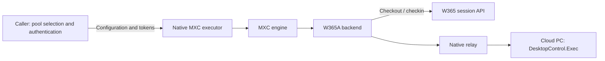

# W365A integration plan

> **Audience:** MXC developers
>
> **Status:** Proposal to add a new experimental backend for W365A
>
> **Scope:** The caller supplies the pool, service endpoints, identity fields,
> and runtime tokens. Pool discovery and selection, token acquisition and
> refresh, and remote pool-access probing are outside MXC for this milestone.
> Typed SDK publication is also outside scope.

## Introduction

Windows 365 for Agents (W365A) provides pools of preconfigured Cloud PCs on
which agents can run commands using the installed applications and environment.
Checkout reserves an existing Cloud PC from a pool; checkin releases the
reservation.

This integration will let MXC callers reserve a Cloud PC, execute multiple
commands while retaining files and other guest state, and release it when
finished. Keeping the same reservation across commands allows a workflow to
build on earlier results.

The W365A control plane manages reservations. The data plane provides readiness
checks and command execution through DesktopControl.Exec, a remote
command-execution capability that must be available on the Cloud PC.

## Proposed Solution

Add a **W365A backend** to MXC's container lifecycle operations. The caller
will select a ready-to-use pool and supply its service configuration and
credentials. MXC will check out a Cloud PC, wait for readiness, execute
commands through DesktopControl.Exec, and check the reservation back in.

The backend will use `w365_agents` as its containment value and Cargo feature.
It will be experimental, requiring explicit runtime opt-in for every
lifecycle operation. The initial delivery will support a demo and initial
selfhost through the native MXC executor.

The initial identity model will be a delegated human user. The caller will
own authentication and token refresh. MXC will neither discover pools nor
prompt the user to sign in.

## How It Works

1. The caller selects a pool, resolves its approved service endpoints, and
   obtains control-plane and data-plane tokens.
2. `provision` checks out a Cloud PC and returns a container ID identifying
   the reservation.
3. `start` waits for the Cloud PC to become ready.
4. The caller runs commands through `exec`, using the same container ID for
   each command. Files and other guest state remain available between calls.
5. `stop` checks the reservation in. `deprovision` provides the same release
   operation for final cleanup, including when stop was skipped.

W365 will own the reservation and guest state. Each command will open a new
relay connection to the same Cloud PC, so MXC will not need a persistent
host connection or a new session daemon. The caller will retain the
container ID and credentials needed for later operations and cleanup.
Commands will share guest state, not a persistent shell.

## Key Design Decisions

1. **Treat stop as terminal checkin.** Stop will release the reservation,
   not suspend it. Another Cloud PC will require an explicit provision.
   The backend will report release acceptance, not completion of the
   service's reset process.

2. **Leave command sequencing with the caller.** The initial backend will
   not add a per-reservation command mutex. The caller will wait for each
   command before normal release; checkin may terminate in-flight work.

3. **Reject unsupported policy.** The Cloud PC and tenant policy will provide
   isolation. MXC filesystem, workload network, UI, and clipboard restrictions
   that the backend cannot enforce will fail validation before allocation.

4. **Make uncertain outcomes explicit.** A lost checkout or command response
   may mean the operation ran. MXC will return available reconciliation
   context without automatically replaying allocation or commands.

## Architecture and Workspace Changes

`W365AgentsRunner` will implement `StatefulSandboxBackend` inside `mxc-sdk`.
`mxc_engine` will own dispatch, experimental authorization, checked binding,
and container ID routing. Executors will remain thin.

The implementation will live under
`src/mxc-sdk/src/backends/w365agents/common/`, with separate modules for
configuration, control-plane calls, data-plane calls, container IDs, and the
exec protocol. Backend defaults and semantic validation will stay in these
modules; shared parsing will preserve optional-field presence.

| Area | Planned change |
| --- | --- |
| `mxc-sdk` backend modules | Add `W365AgentsRunner`, service clients, validation, and native relay. |
| Engine registry and lifecycle dispatch | Register experimental `w365_agents`, route `w365:` IDs, and report feature-unavailable errors. |
| Development contract | Add `w365Agents` phase types and adapters in `1.1.0-alpha`; generate schema and TypeScript artifacts. |
| Cargo features and native packaging | Add opt-in feature forwarding and feature-enabled executor artifacts through existing build paths. |
| Tests and CI | Add feature-enabled contract and loopback tests in build CI, plus a manually runnable example for real-host and pool validation. |
| Backend documentation | Add a usage guide under `docs/backends/w365-agents/` and update schema, lifecycle, and validation references. |

### Service Integration

The backend will integrate with the following APIs.

| MXC operation | Service interaction | Result |
| --- | --- | --- |
| `provision` | `POST /api/pools/{poolId}/sessions?api-version=2.0` | Container ID and checkout metadata. |
| `start` | Poll `/computers/{computerId}/status` | Readiness and native exec capability. |
| `exec` | TLS HTTP upgrade to `/computers/{computerId}/microsoft.mxc-exec` | Relayed I/O and remote exit code. |
| `stop` | `DELETE /api/sessions/{sessionId}?api-version=2.0` | `releaseRequested: true`, `restartable: false`. |
| `deprovision` | Same release operation as stop | Idempotent final cleanup. |

The direct session API's human-user flow, API versions, and header requirements
will be confirmed with the service owner before live integration.

### Container Identity

The proposed W365A backend will represent a reservation with an opaque ID,
encoded as `w365:{poolId}:{computerId}`, with canonical GUID segments.
Callers will pass this ID to subsequent lifecycle operations. It will contain
no credentials or endpoints.

The caller will persist the returned ID and retain its account and deployment
context separately. The service will authorize each operation. Release will
not depend on an earlier runner object or a live exec connection.

## Configuration Semantics

### Caller Inputs

| Input | Proposed configuration |
| --- | --- |
| Pool | `w365Agents.provision.poolId` |
| Human identity | Provision `userType: "HumanUser"` and `userObjectId` |
| Control-plane host | Phase `cpBaseUrl` or `W365A_CONTROLPLANE_URL`; bare hostname without scheme or path |
| Data-plane suffix | Phase `dpSuffix` or `W365A_DP_SUFFIX`; host constructed as `{poolId}.{suffix}` |
| Provision token | `w365Agents.provision.cpBearerToken` or `W365A_CP_TOKEN` |
| Start token | `w365Agents.start.dpBearerToken` or `W365A_DP_TOKEN` |
| Exec token | `w365Agents.exec.bearerToken` or `W365A_DP_TOKEN` |
| Stop token | `w365Agents.stop.cpBearerToken` or `W365A_CP_TOKEN` |
| Deprovision token | `w365Agents.deprovision.cpBearerToken` or `W365A_CP_TOKEN` |

The caller will obtain resource-specific tokens and refresh them before later
operations, including final release. Identity fields will describe checkout
intent; they will not authenticate the user. Runtime principals, audiences,
and deployment coordinates will remain consistent with the reservation.

Service endpoints will be supplied by the caller, not discovered by MXC.

### Process and Policy Fields

| Field or capability | W365A behavior |
| --- | --- |
| Command line, working directory, explicit environment | Forwarded to the remote process. |
| Exec timeout | Applied to the remote command through the exec protocol. |
| Host filesystem paths and mounts | Rejected. |
| MXC workload network policy and runtime proxy | Rejected. |
| MXC UI and clipboard restrictions | Rejected. |
| SDK-owned piped process handles and PTY | Unsupported in the initial integration. |

The host environment and credentials will not be forwarded automatically.
Guest applications, storage, and network access will be governed by the pool's
tenant-managed configuration.

## Error Handling and Output Semantics

### Command I/O

Execution will use `ExecStdio::Relayed`. MXC will send `EXEC_START` with the
command, working directory, explicit environment, and timeout, then relay
host stdin and remote stdout/stderr until completion.

The returned `ExecHandle` will describe a completed command, without SDK-owned
pipes or a live remote cancellation handle. Nonzero remote exit codes will
be returned unchanged. Transport loss before an exit frame will be reported
as abnormal completion rather than a successful remote exit. The target Cloud
PC must expose a compatible DesktopControl.Exec host and relay.

### Failures and Recovery

Service errors will include operation-specific `details.code` values,
with HTTP status and request IDs where available.

Unsupported policy will be rejected before checkout. Uncertain checkout and
execution outcomes will not trigger automatic replay. Release acceptance
will not imply that the Cloud PC has finished resetting.

Retry flags describe the error; they do not initiate retries. The backend
will not reacquire a Cloud PC after a relay failure. The caller will retain
the reservation ID for explicit stop or deprovision.

### Session Lifetime

W365 will manage session lifetime and expiration. The backend will not track
session validity locally or send keepalive requests. A later exec will attempt
to connect using the supplied reservation ID and report any service rejection
through the exec error mapping; there is no dedicated session-expired result.
The backend will not automatically acquire a replacement Cloud PC. Reset or
expiration can lose guest work, so callers will checkpoint important results
outside the reservation.

## Security Model

The isolation boundary will be the tenant-managed Cloud PC, rather than a
local sandbox on the caller's machine. Pool access will not imply that MXC
has verified the guest's effective policy.

Service connections will use TLS certificate validation. Malformed endpoint
forms and credential-bearing URLs will be rejected. An explicit host override
will require an explicit matching token, and redirects will not forward
credentials to an unrelated origin.

Tokens will be redacted from diagnostics and kept out of example files,
command-line arguments, logs, and telemetry. A caller may supply tokens
through a restricted child process's environment, but that environment is
not a protected secret store.

Host-availability APIs will remain local and account-free. W365A will use
`ProbeCoverage::NotDetected`, because local checks cannot establish access
to a remote pool.

## Development Phases

### Phase 1 - Service Contract and Checkout

Confirm the direct human-user flow, runtime audiences, service coordinates,
session identity, and checkout reconciliation. Add experimental
registration, feature gates, phase contracts, checked binding, container IDs,
policy validation, checkout, and release as a functional vertical slice.

### Phase 2 - Readiness and Command Execution

Add readiness polling, TLS upgrade, protocol framing, synchronous I/O relay,
exit propagation, and refusal of unsupported execution modes. Validate the
protocol with loopback tests and a compatible DesktopControl.Exec host.

### Phase 3 - Manually Runnable Example

Add an example script under `tests/scripts/` that reserves an existing Cloud PC,
waits for readiness, runs repeated commands retaining guest state, and
releases the reservation in final cleanup. The person running it will supply
the pool ID, service endpoints, human-user identity fields, and valid
control-plane and data-plane tokens. The example will not discover pools or
acquire credentials. Feature-enabled build artifacts and the backend usage
guide will document how to run it and supply those inputs.

## Testing Strategy

Feature-enabled contract and loopback tests will run in applicable build CI.
Scheduled live validation is outside the scope of this implementation.

### Contract and Loopback Tests

| Scenario | What it validates |
| --- | --- |
| Phase configuration and credentials | Supplied values reach the correct operation; missing inputs and malformed IDs fail before remote actions. |
| Experimental gating | Every phase requires runtime opt-in and reports unavailable build features. |
| Policy validation | Unsupported policy fails before allocation. |
| Control-plane requests | Checkout/release paths, headers, response validation, and idempotent release handling. |
| Readiness and relay | Polling, bounded framing, stdin/stdout/stderr, and nonzero exit propagation. |
| Failure handling | Token expiry, throttling, lost responses, uncertain outcomes, and cleanup failures remain explicit without automatic replay. |
| Endpoint trust and privacy | Host/token pairing, TLS, redirects, and credential redaction. |
| Availability | Existing host probes make no authentication or remote service calls. |

## References

- [MXC backend plug-in guide](../architecture/container-lifecycle.md#11-plug-in-guide-for-new-backends)
- [MXC versioning](../architecture/versioning.md)
- [Windows 365 for Agents overview](https://learn.microsoft.com/en-us/windows-365/agents/introduction-windows-365-for-agents)
- [Session checkout and checkin](https://learn.microsoft.com/en-us/windows-365/agents/mcp-tool-overview#computer-get-session-checkout-and-checkin)
- [W365A session lifecycle](https://learn.microsoft.com/en-us/windows-365/agents/agent-session-lifecycle)
